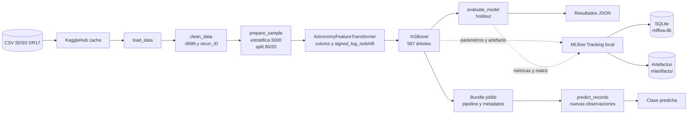
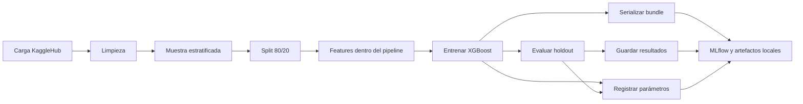
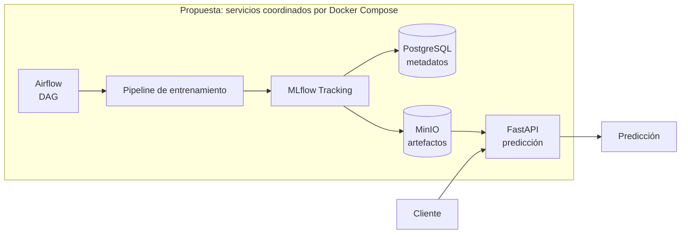

# Clasificación de objetos astronómicos — proyecto MLOps

Proyecto académico para la asignatura Operaciones de Aprendizaje de Máquina I (MLOps), de la Carrera de Especialización en Inteligencia Artificial. El trabajo parte de un clasificador multiclase de objetos astronómicos SDSS DR17, cuyo modelo seleccionado es XGBoost, y avanza hacia un flujo organizado y reproducible.

> **Estado actual:** implementación local en Python 3.12 con uv, pipeline modular, una corrida reducida registrada en MLflow local y pruebas iniciales de preprocesamiento. No hay repositorio Git inicializado en la carpeta oficial.

## Índice

1. [Presentación](#presentacion)
2. [Objetivo](#objetivo)
3. [Problema de ML](#problema-de-ml)
4. [Dataset SDSS DR17](#dataset-sdss-dr17)
5. [Clases](#clases)
6. [Preparación y features](#preparacion-y-features)
7. [Modelo e hiperparámetros](#modelo-e-hiperparametros)
8. [Resultados de validación](#resultados-de-validacion)
9. [Arquitectura actual](#arquitectura-actual)
10. [Arquitectura objetivo](#arquitectura-objetivo)
11. [Estructura del proyecto](#estructura-del-proyecto)
12. [Tecnologías](#tecnologias)
13. [Requisitos](#requisitos)
14. [Instalación con uv](#instalacion-con-uv)
15. [Ejecución](#ejecucion)
16. [Pruebas](#pruebas)
17. [Serialización e inferencia](#serializacion-e-inferencia)
18. [MLflow Tracking](#mlflow-tracking)
19. [Experimentos y artefactos](#experimentos-y-artefactos)
20. [Limitaciones](#limitaciones)
21. [Estado del proyecto](#estado-del-proyecto)
22. [Roadmap](#roadmap)
23. [Referencias](#referencias)
24. [Licencia y carácter académico](#licencia-y-caracter-academico)

<a id="presentacion"></a>
## 1. Presentación del proyecto

Esta carpeta de proyecto conserva el notebook original del trabajo de Aprendizaje de Máquina y añade una implementación local, modular y reproducible para validar el modelo final. La corrida automatizada actual es una **validación técnica reducida**, no una nueva evaluación completa del trabajo original.

<a id="objetivo"></a>
## 2. Objetivo y descripción general

El objetivo del TP de MLOps es transformar progresivamente el clasificador en una solución mantenible y preparada para etapas futuras de orquestación y despliegue. En el estado actual se cubren carga, limpieza, ingeniería de variables, split estratificado, entrenamiento de XGBoost, evaluación, serialización y tracking local.

<a id="problema-de-ml"></a>
## 3. Problema de Machine Learning

Es una clasificación supervisada multiclase: a partir de mediciones fotométricas y espectroscópicas, asignar cada observación a GALAXY, QSO o STAR. La variable objetivo del dataset es class.

<a id="dataset-sdss-dr17"></a>
## 4. Dataset SDSS DR17

El notebook usa el Stellar Classification Dataset — SDSS17 publicado en Kaggle por fedesoriano. El CSV esperado es star_classification.csv; la carga se realiza con KaggleHub, que mantiene su propia caché y descarga el dataset cuando no está disponible localmente.

El notebook describe 100.000 observaciones y 18 columnas en el CSV de origen. Tras descartar obj_ID (guardado con pérdida de precisión), la carga obtiene 100.000 filas y 17 columnas. La limpieza quita una fila centinela y rerun_ID, y deja 99.999 filas y 16 columnas. El directorio data/ del proyecto es solo un placeholder: el código actual no copia el dataset a ese directorio.

<a id="clases"></a>
## 5. Clases de clasificación

| Clase | Identificador numérico |
|---|---:|
| GALAXY | 0 |
| QSO | 1 |
| STAR | 2 |

La codificación coincide con LabelEncoder del notebook: orden alfabético. La configuración autoritativa está en src/config.py.

<a id="preparacion-y-features"></a>
## 6. Preparación de datos y feature engineering

La carga lee obj_ID y spec_obj_ID como texto, descarta obj_ID y conserva el resto de columnas. La limpieza sigue la regla del notebook: elimina una fila si alguna banda u, g, r, i o z contiene -9999 y elimina rerun_ID. La muestra de validación se estratifica por class.

El transformer que acompaña al modelo calcula las variables en el orden que usa A_completo:

| Feature | Fórmula |
|---|---|
| u, g, r, i, z | Magnitudes originales |
| u_g | u − g |
| g_r | g − r |
| r_i | r − i |
| i_z | i − z |
| signed_log_redshift | sign(redshift) × log1p(abs(redshift)) |

El pipeline serializado contiene este transformer. En inferencia recibe las seis columnas crudas u, g, r, i, z y redshift, y aplica las mismas fórmulas antes de XGBoost.

<a id="modelo-e-hiperparametros"></a>
## 7. Modelo XGBoost e hiperparámetros

El trabajo original seleccionó XGBoost optimizado. El pipeline local usa los valores centralizados en src/config.py:

| Parámetro | Valor |
|---|---:|
| n_estimators | 587 |
| learning_rate | 0.0167 |
| max_depth | 9 |
| min_child_weight | 2 |
| subsample | 0.8253 |
| colsample_bytree | 0.8430 |
| reg_lambda | 5.8723 |
| tree_method | hist |
| eval_metric | mlogloss |
| n_jobs | -1 |
| random_state | 42 |

La corrida local no ejecuta RandomizedSearchCV, GridSearchCV ni validación cruzada.

<a id="resultados-de-validacion"></a>
## 8. Resultados de validación

Los valores siguientes pertenecen exclusivamente a la corrida técnica reducida registrada en MLflow: muestra estratificada de 5.000 observaciones, con 4.000 para entrenamiento y 1.000 para prueba.

| Métrica | Resultado de la muestra reducida |
|---|---:|
| Accuracy | 0.9830 |
| F1 macro | 0.980720 |

No son directamente comparables con las métricas de la evaluación original, que se obtuvo mediante su propio flujo y partición. No se ejecutó entrenamiento adicional para preparar este README.


<a id="arquitectura-actual"></a>
## 9. Arquitectura actual

La siguiente arquitectura representa el código que existe hoy. El transformer de features forma parte del pipeline sklearn serializado, por lo que entrenamiento e inferencia comparten las mismas fórmulas.

[Ver diagrama SVG de arquitectura actual](docs/diagrams/architecture-current.svg) · [Fuente Mermaid](docs/diagrams/architecture-current.mmd)



### Flujo de entrenamiento

[Ver diagrama SVG del pipeline](docs/diagrams/training-pipeline.svg) · [Fuente Mermaid](docs/diagrams/training-pipeline.mmd)



<a id="arquitectura-objetivo"></a>
## 10. Arquitectura objetivo (propuesta)

Este diagrama describe una **arquitectura futura**, no implementada ni validada en este proyecto. Muestra una dirección posible para orquestar y desplegar el flujo cuando las siguientes etapas sean aprobadas.

[Ver diagrama SVG de arquitectura propuesta](docs/diagrams/architecture-proposed.svg) · [Fuente Mermaid](docs/diagrams/architecture-proposed.mmd)



<a id="estructura-del-proyecto"></a>
## 11. Estructura del proyecto

Estructura observada y documentación añadida en esta entrega:

```text
Tp_Mlops/
├── data/                         # Placeholder; el CSV se usa desde caché KaggleHub
├── docs/diagrams/                # Fuentes Mermaid y diagramas SVG
├── mlartifacts/                  # Artefactos del run MLflow local
├── mlflow.db                     # Tracking SQLite local (ignorado por Git)
├── models/
│   ├── xgboost_validation.joblib # Artefacto histórico: XGBClassifier directo
│   ├── xgboost_validation_metadata.json
│   └── xgboost_<run_id>*.{joblib,json} # Bundles modulares por run
├── notebooks/
│   └── AdMq1_TP_Final_Marroquin_Orozco_VF.ipynb
├── outputs/                      # Evaluaciones JSON
├── src/
│   ├── config.py
│   ├── data/data_loader.py
│   ├── features/preprocessing.py
│   ├── models/{train,predict,artifacts}.py
│   ├── evaluation/evaluate.py
│   ├── pipelines/training_pipeline.py
│   └── validate_model.py
├── tests/
│   ├── conftest.py
│   └── test_preprocessing.py
├── .venv/                         # Entorno local, excluido de Git
├── .gitignore
├── pyproject.toml
├── uv.lock
└── README.md
```

<a id="tecnologias"></a>
## 12. Tecnologías utilizadas

| Tecnología | Uso actual |
|---|---|
| Python 3.12 | Lenguaje y entorno |
| uv 0.11.25 | Dependencias, lockfile y ejecución |
| pandas, NumPy | Datos y transformaciones |
| scikit-learn | Split estratificado, LabelEncoder y Pipeline |
| XGBoost | Clasificador seleccionado |
| KaggleHub | Acceso al dataset con caché |
| joblib | Serialización del bundle modular |
| MLflow 2.22.5 + SQLite | Tracking local de experimentos |
| pytest | Pruebas iniciales |
| Jupyter / ipykernel | Notebook original y kernel local |

LightGBM y otras bibliotecas también están declaradas porque el notebook original las importa o las compara; el pipeline modular actual entrena únicamente XGBoost. MLflow se configuró con SQLite local y almacenamiento de artefactos en el sistema de archivos. No es una instalación distribuida.

<a id="requisitos"></a>
## 13. Requisitos previos

- Windows 10/11 de 64 bits.
- Python 3.12.
- uv instalado y accesible desde PowerShell.
- Conexión/credenciales KaggleHub si el dataset todavía no está en su caché.
- Espacio local para el entorno virtual, la base SQLite y los artefactos.

<a id="instalacion-con-uv"></a>
## 14. Instalación con uv

Desde PowerShell, cambiar a la raíz del proyecto y sincronizar dependencias:

```powershell
Set-Location "C:\Users\Duvan Orozco\Desktop\DUVAN\UBA\ESPECIALIZACION INTELIGENCIA ARTIFICIAL\3. Tercer Bimestre\Mlops\Tp_Mlops"
uv sync
```

El proyecto requiere Python 3.12 y uv crea o sincroniza **.venv** a partir de **pyproject.toml** y **uv.lock**. Para activar el entorno en PowerShell:

```powershell
.\.venv\Scripts\Activate.ps1
```

<a id="ejecucion"></a>
## 15. Ejecución del proyecto

El pipeline de validación reducida se ejecuta desde la raíz:

```powershell
uv run python -m src.validate_model
```

Por defecto usa una muestra estratificada de 5.000 filas y entrena el XGBoost configurado (587 árboles). El tiempo depende del hardware. Esta ejecución **vuelve a entrenar** y escribe un nuevo run y artefactos; no la ejecutes solo para consultar los resultados existentes.

Para una prueba técnica menor, el CLI acepta otro tamaño:

```powershell
uv run python -m src.validate_model --sample-size 300
```

KaggleHub reutiliza la caché del usuario y descarga el dataset si hace falta. El código actual no ofrece un modo de solo inferencia por CLI.

<a id="pruebas"></a>
## 16. Ejecución de pruebas

La última comprobación registrada ejecutó únicamente:

```powershell
uv run pytest tests/test_preprocessing.py -q
```

Resultado: **5 passed in 0.20s**. Estas pruebas cubren limpieza, fórmulas, orden de features, mapeo de clases y muestreo estratificado, sin descargar Kaggle ni entrenar modelos.

**Cobertura pendiente:** no hay un archivo de pruebas independiente para bundle/serialización/carga/predicción. **conftest.py** define una fixture de XGBoost sintético de tres árboles, pero las pruebas actuales de preprocesamiento no la solicitan. No se generó un informe porcentual de cobertura. La suite completa no se volvió a ejecutar para preparar esta documentación.


<a id="serializacion-e-inferencia"></a>
## 17. Serialización e inferencia

Los bundles modulares se guardan con nombres basados en el run ID bajo models/. Incluyen el pipeline sklearn, el clasificador, el orden de features, el mapeo de clases, hiperparámetros, transformaciones y metadatos de la corrida.

La interfaz predict_records espera observaciones crudas con columnas u, g, r, i, z y redshift. El transformer incluido en el bundle calcula las features. Ejemplo usando el bundle actualmente registrado:

```python
from pathlib import Path
import pandas as pd
from src.models.predict import predict_records

observaciones = pd.DataFrame([{
    "u": 20.1, "g": 19.7, "r": 19.3, "i": 19.0, "z": 18.8,
    "redshift": 0.42,
}])

bundle = Path("models/xgboost_aa56fc6e192642ef9160c29a23cd81b7.joblib")
predicciones = predict_records(observaciones, bundle)
print(predicciones)
```

**Compatibilidad de artefactos:** el archivo histórico models/xgboost_validation.joblib contiene un XGBClassifier directo y no incluye el transformer como bundle. predict_records espera el formato bundle modular; el artefacto histórico no es intercambiable directamente. Ambos formatos se conservan y no se sobrescriben.

<a id="mlflow-tracking"></a>
## 18. Integración con MLflow

El pipeline configura MLflow Tracking local. La corrida existente corresponde al experimento **sdss17-xgboost-validation**, run ID **aa56fc6e192642ef9160c29a23cd81b7**, con estado **FINISHED**. Registra parámetros, semilla, tamaño de muestra, features, mapeo, métricas, matriz de confusión y archivos del run.

- Backend: SQLite local en mlflow.db.
- Almacenamiento de artefactos: mlartifacts/.
- URI definido por el código: SQLite en la raíz del proyecto.
- No se utiliza infraestructura remota ni servicio de base de datos externo.

Para consultar la interfaz desde PowerShell, en la raíz del proyecto:

```powershell
uv run mlflow ui --backend-store-uri "sqlite:///mlflow.db" --host 127.0.0.1 --port 5000
```

Abrir http://127.0.0.1:5000. El comando inicia la UI local; debe permanecer ejecutándose en esa terminal mientras se consulta. El run descrito arriba fue consultado en el almacén existente; este README no creó una corrida nueva.

<a id="experimentos-y-artefactos"></a>
## 19. Organización de experimentos y artefactos

Cada invocación del pipeline abre un run nuevo y usa su identificador para nombrar bundle, metadatos y resultados:

- models/xgboost_<run_id>.joblib: bundle modular para inferencia.
- models/xgboost_<run_id>_metadata.json: schema, mapping, transformaciones, parámetros y metadatos.
- outputs/validation_<run_id>.json: métricas, reporte por clase y matriz de confusión.
- mlflow.db: metadatos locales de experimentos.
- mlartifacts/<run_id>/: archivos adjuntos al run.

Los artefactos históricos models/xgboost_validation.joblib y outputs/validation_results.json pertenecen a una corrida anterior y usan el formato directo XGBoost. .gitignore excluye models/** y outputs/** excepto .gitkeep; por ello, dichos binarios/JSON no se agregan automáticamente a Git. También excluye mlflow.db y mlartifacts/.

<a id="limitaciones"></a>
## 20. Limitaciones actuales

- La evaluación descrita es una muestra estratificada reducida; no sustituye la evaluación completa del notebook.
- La carga depende de KaggleHub y de la disponibilidad del dataset en caché o en red.
- Las pruebas actuales se concentran en preprocessing; falta cobertura automatizada separada de serialización y predicción.
- Hay dos formatos de artefacto; predict_records admite el bundle modular.
- SQLite y mlartifacts son locales a esta máquina; no constituyen tracking distribuido.
- models/** y outputs/** están ignorados por Git, y mlruns/ no aparece en las reglas actuales de .gitignore.
- La carpeta oficial no contiene .git; no hay historial de commits ni publicación confirmada.
- No se declara una licencia de software en este proyecto.
- El dataset requiere respetar las condiciones de distribución de su fuente.

<a id="estado-del-proyecto"></a>
## 21. Estado del proyecto

| Componente | Estado observado |
|---|---|
| Entorno Python 3.12 y uv | Configurado; uv.lock sincronizado |
| Notebook original | Conservado; SHA-256 revisado |
| Código modular | Implementado en src/ |
| Pipeline XGBoost reducido | Ejecutado; una corrida existente |
| Artefacto modular y tracking | Guardados y consultables localmente |
| Pruebas de preprocesamiento | 5 aprobadas en la última ejecución auditada |
| Pruebas de serialización/inferencia | No implementadas como pruebas independientes |
| Repositorio Git | No inicializado en la carpeta oficial |
| Airflow, Docker Compose, PostgreSQL, MinIO, FastAPI | No implementados |

La carpeta no es actualmente un repositorio Git. No se afirma publicación en GitHub ni historial de commits. Para el primer commit se espera incluir código, README, diagramas, notebook, pyproject.toml y uv.lock; revisar si se adjuntan modelo y resultados, dado que .gitignore los excluye. El entorno, cachés, base MLflow y artefactos locales suelen mantenerse fuera del repositorio salvo requisito expreso de entrega.

<a id="roadmap"></a>
## 22. Roadmap

| Etapa | Alcance | Estado |
|---|---|---|
| **1 — Implementación local** | Entorno, organización, modularización, pipeline, evaluación/serialización, MLflow local y pruebas iniciales | Implementada localmente; pruebas de preprocesamiento, cobertura de inferencia pendiente |
| **2 — Consolidación del primer avance** | README, organización Git, política de artefactos, pruebas de serialización e inferencia | En curso; Git y pruebas pendientes |
| **3 — Orquestación** | Airflow, DAG y ejecución del pipeline desde el orquestador | Pendiente |
| **4 — Infraestructura** | Docker, Docker Compose, PostgreSQL, MinIO e integración de MLflow | Pendiente |
| **5 — Servicio de inferencia** | FastAPI, contrato request/response, endpoint y carga del bundle | Pendiente |
| **6 — Integración final** | Integración de servicios, validación completa y documentación del despliegue | Pendiente |

Las etapas 3 a 6 son propuestas de trabajo futuro, no capacidades disponibles en la implementación actual.

<a id="referencias"></a>
## 23. Referencias

1. [Stellar Classification Dataset — SDSS17 (Kaggle)](https://www.kaggle.com/datasets/fedesoriano/stellar-classification-dataset-sdss17).
2. Abdurro'uf et al. (2022). [The Seventeenth Data Release of the Sloan Digital Sky Surveys](https://doi.org/10.3847/1538-4365/ac4414).
3. Chen, T. y Guestrin, C. (2016). XGBoost: A Scalable Tree Boosting System. Proceedings of KDD.
4. [MLflow Tracking documentation](https://mlflow.org/docs/latest/tracking/).
5. Notebook de referencia: notebooks/AdMq1_TP_Final_Marroquin_Orozco_VF.ipynb (se conserva sin modificaciones).

<a id="licencia-y-caracter-academico"></a>
## 24. Licencia y carácter académico

Este material se desarrolla con fines académicos para la Carrera de Especialización en Inteligencia Artificial. No se encontró un archivo LICENSE en el estado auditado; por tanto, no se declara una licencia de software para el código. La licencia y atribución del dataset deben verificarse en la fuente antes de redistribuirlo.


