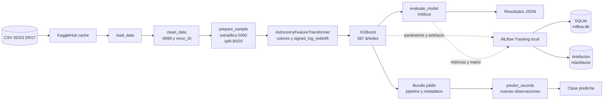
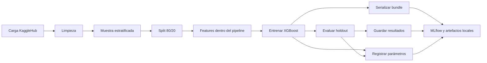
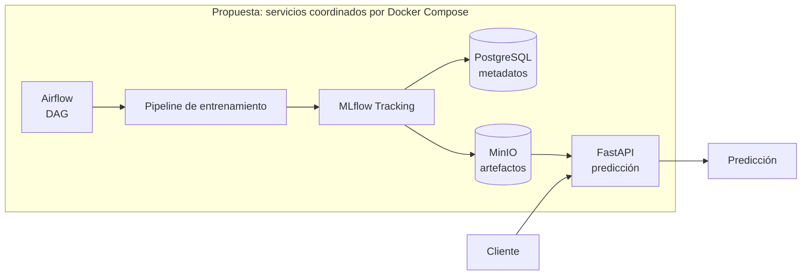

# Clasificación de objetos astronómicos — proyecto MLOps

Proyecto académico para la asignatura Operaciones de Aprendizaje de Máquina I (MLOps), de la Carrera de Especialización en Inteligencia Artificial. El trabajo parte de un clasificador multiclase de objetos astronómicos SDSS DR17, cuyo modelo seleccionado es XGBoost, y avanza hacia un flujo organizado y reproducible.

> **Estado actual:** el proyecto cuenta con un entorno local con Python 3.12 y uv, un pipeline modular, una corrida reducida registrada en MLflow y pruebas iniciales de preprocesamiento. El repositorio Git está publicado en GitHub en la rama `main`.

## Índice

1. [Presentación](#presentacion)
2. [Objetivo](#objetivo)
3. [Problema de ML](#problema-de-ml)
4. [Dataset SDSS DR17](#dataset-sdss-dr17)
5. [Clases](#clases)
6. [Preparación y features](#preparacion-y-features)
7. [Modelo e hiperparámetros](#modelo-e-hiperparametros)
8. [Resultados de validación](#resultados-de-validacion)
9. [Arquitectura actual](#arquitectura-actual)
10. [Arquitectura objetivo](#arquitectura-objetivo)
11. [Estructura del proyecto](#estructura-del-proyecto)
12. [Tecnologías](#tecnologias)
13. [Requisitos](#requisitos)
14. [Instalación con uv](#instalacion-con-uv)
15. [Ejecución](#ejecucion)
16. [Pruebas](#pruebas)
17. [Serialización e inferencia](#serializacion-e-inferencia)
18. [MLflow Tracking](#mlflow-tracking)
19. [Experimentos y artefactos](#experimentos-y-artefactos)
20. [Limitaciones](#limitaciones)
21. [Estado del proyecto](#estado-del-proyecto)
22. [Roadmap](#roadmap)
23. [Referencias](#referencias)
24. [Consideraciones finales](#consideraciones-finales)

<a id="presentacion"></a>
## 1. Presentación del proyecto

El proyecto conserva el notebook original del trabajo de Aprendizaje de Máquina y agrega una implementación local y modular para validar el modelo seleccionado. La corrida automatizada actual es una **validación técnica reducida**; no reemplaza la evaluación completa del trabajo original.

<a id="objetivo"></a>
## 2. Objetivo y descripción general

El TP de MLOps busca organizar el clasificador en un flujo reproducible y mantenible, que pueda ampliarse en etapas posteriores. La implementación actual incluye carga y limpieza de datos, ingeniería de variables, partición estratificada, entrenamiento y evaluación de XGBoost, serialización y seguimiento local con MLflow.

<a id="problema-de-ml"></a>
## 3. Problema de Machine Learning

El problema es de clasificación supervisada multiclase. A partir de mediciones fotométricas y espectroscópicas, el modelo asigna cada observación a una de tres clases: GALAXY, QSO o STAR. La variable objetivo del dataset se llama `class`.

<a id="dataset-sdss-dr17"></a>
## 4. Dataset SDSS DR17

El notebook utiliza el conjunto Stellar Classification Dataset — SDSS17, publicado en Kaggle por fedesoriano. El archivo esperado es `star_classification.csv`. La carga se realiza con KaggleHub, que reutiliza su caché y descarga el archivo si todavía no está disponible localmente.

El notebook informa 100.000 observaciones y 18 columnas en el CSV de origen. La carga descarta `obj_ID`, almacenado con pérdida de precisión, y conserva 100.000 filas y 17 columnas. Luego se elimina la fila con valores centinela y la columna `rerun_ID`; el conjunto limpio queda con 99.999 filas y 16 columnas. La carpeta `data/` solo conserva su marcador: el código no copia allí el dataset.

<a id="clases"></a>
## 5. Clases de clasificación

| Clase | Identificador numérico |
|---|---:|
| GALAXY | 0 |
| QSO | 1 |
| STAR | 2 |

La codificación sigue el orden alfabético que aplica `LabelEncoder` en el notebook. El mapeo usado por el pipeline está definido en `src/config.py`.

<a id="preparacion-y-features"></a>
## 6. Preparación de datos y feature engineering

La carga interpreta `obj_ID` y `spec_obj_ID` como texto, descarta `obj_ID` y conserva las demás columnas. La limpieza aplica la regla del notebook: elimina las filas en las que alguna banda (`u`, `g`, `r`, `i` o `z`) contiene `-9999`, y luego elimina `rerun_ID`. La muestra de validación se estratifica según `class`.

El transformer incluido en el pipeline calcula las variables en el orden definido por `A_completo`:

| Feature | Fórmula |
|---|---|
| u, g, r, i, z | Magnitudes originales |
| u_g | u − g |
| g_r | g − r |
| r_i | r − i |
| i_z | i − z |
| signed_log_redshift | sign(redshift) × log1p(abs(redshift)) |

El pipeline serializado incluye este transformer. Para inferencia recibe las seis columnas originales (`u`, `g`, `r`, `i`, `z` y `redshift`) y aplica las mismas fórmulas antes de pasar los datos a XGBoost.

<a id="modelo-e-hiperparametros"></a>
## 7. Modelo XGBoost e hiperparámetros

El trabajo original seleccionó una versión optimizada de XGBoost. El pipeline local toma sus hiperparámetros de `src/config.py`:

| Parámetro | Valor |
|---|---:|
| n_estimators | 587 |
| learning_rate | 0.0167 |
| max_depth | 9 |
| min_child_weight | 2 |
| subsample | 0.8253 |
| colsample_bytree | 0.8430 |
| reg_lambda | 5.8723 |
| tree_method | hist |
| eval_metric | mlogloss |
| n_jobs | -1 |
| random_state | 42 |

La ejecución local no realiza búsquedas con `RandomizedSearchCV` o `GridSearchCV`, ni validación cruzada.

<a id="resultados-de-validacion"></a>
## 8. Resultados de validación

Los valores siguientes corresponden a la corrida técnica reducida registrada en MLflow. Se utilizó una muestra estratificada de 5.000 observaciones: 4.000 para entrenamiento y 1.000 para prueba.

| Métrica | Resultado de la muestra reducida |
|---|---:|
| Accuracy | 0.9830 |
| F1 macro | 0.980720 |

Estas métricas no se comparan directamente con las de la evaluación original, que utilizó otro flujo y otra partición. La revisión de este README no requirió ejecutar entrenamientos.


<a id="arquitectura-actual"></a>
## 9. Arquitectura actual

La siguiente arquitectura representa el código que existe hoy. El transformer de features forma parte del pipeline sklearn serializado, por lo que entrenamiento e inferencia comparten las mismas fórmulas.

[Ver diagrama SVG de arquitectura actual](docs/diagrams/architecture-current.svg) · [Fuente Mermaid](docs/diagrams/architecture-current.mmd)



### Flujo de entrenamiento

[Ver diagrama SVG del pipeline](docs/diagrams/training-pipeline.svg) · [Fuente Mermaid](docs/diagrams/training-pipeline.mmd)



<a id="arquitectura-objetivo"></a>
## 10. Arquitectura objetivo (propuesta)

El diagrama muestra una **arquitectura futura** que todavía no está implementada ni validada. Resume una alternativa para orquestar y desplegar el flujo en etapas posteriores.

[Ver diagrama SVG de arquitectura propuesta](docs/diagrams/architecture-proposed.svg) · [Fuente Mermaid](docs/diagrams/architecture-proposed.mmd)



<a id="estructura-del-proyecto"></a>
## 11. Estructura del proyecto

La estructura actual incluye los siguientes componentes:

```text
Tp_Mlops/
├── data/                         # Placeholder; el CSV se usa desde caché KaggleHub
├── docs/diagrams/                # Fuentes Mermaid y diagramas SVG
├── mlartifacts/                  # Artefactos del run MLflow local
├── mlflow.db                     # Tracking SQLite local (ignorado por Git)
├── models/
│   ├── xgboost_validation.joblib # Artefacto histórico: XGBClassifier directo
│   ├── xgboost_validation_metadata.json
│   └── xgboost_<run_id>*.{joblib,json} # Bundles modulares por run
├── notebooks/
│   └── AdMq1_TP_Final_Marroquin_Orozco_VF.ipynb
├── outputs/                      # Evaluaciones JSON
├── src/
│   ├── config.py
│   ├── data/data_loader.py
│   ├── features/preprocessing.py
│   ├── models/{train,predict,artifacts}.py
│   ├── evaluation/evaluate.py
│   ├── pipelines/training_pipeline.py
│   └── validate_model.py
├── tests/
│   ├── conftest.py
│   └── test_preprocessing.py
├── .venv/                         # Entorno local, excluido de Git
├── .gitignore
├── pyproject.toml
├── uv.lock
└── README.md
```

<a id="tecnologias"></a>
## 12. Tecnologías utilizadas

| Tecnología | Uso actual |
|---|---|
| Python 3.12 | Lenguaje y entorno |
| uv 0.11.25 | Dependencias, lockfile y ejecución |
| pandas, NumPy | Datos y transformaciones |
| scikit-learn | Split estratificado, LabelEncoder y Pipeline |
| XGBoost | Clasificador seleccionado |
| KaggleHub | Acceso al dataset con caché |
| joblib | Serialización del bundle modular |
| MLflow 2.22.5 + SQLite | Tracking local de experimentos |
| pytest | Pruebas iniciales |
| Jupyter / ipykernel | Notebook original y kernel local |

LightGBM y otras bibliotecas están declaradas porque el notebook original las importa o compara; el pipeline modular entrena solo XGBoost. MLflow usa SQLite local y guarda los artefactos en el sistema de archivos. Esta configuración no es distribuida.

<a id="requisitos"></a>
## 13. Requisitos previos

- Windows 10/11 de 64 bits.
- Python 3.12.
- uv instalado y accesible desde PowerShell.
- Conexión a internet y, si KaggleHub lo requiere y el dataset no está en caché, credenciales de Kaggle configuradas localmente.
- Espacio local para el entorno virtual, la base SQLite y los artefactos.

<a id="instalacion-con-uv"></a>
## 14. Instalación con uv

Desde PowerShell, cambiar a la raíz del proyecto y sincronizar dependencias:

```powershell
Set-Location "C:\Users\Duvan Orozco\Desktop\DUVAN\UBA\ESPECIALIZACION INTELIGENCIA ARTIFICIAL\3. Tercer Bimestre\Mlops\Tp_Mlops"
uv sync
```

El proyecto requiere Python 3.12. `uv sync` crea o actualiza `.venv` usando `pyproject.toml` y `uv.lock`. En PowerShell, el entorno se activa así:

```powershell
.\.venv\Scripts\Activate.ps1
```

<a id="ejecucion"></a>
## 15. Ejecución del proyecto

El pipeline de validación reducida se ejecuta desde la raíz:

```powershell
uv run python -m src.validate_model
```

Por defecto, toma una muestra estratificada de 5.000 filas y entrena XGBoost con 587 árboles. La duración depende del equipo. Cada ejecución **vuelve a entrenar** y crea un nuevo run y nuevos artefactos; no es necesario ejecutarla para consultar los resultados existentes.

Para una prueba técnica menor, el CLI acepta otro tamaño:

```powershell
uv run python -m src.validate_model --sample-size 300
```

KaggleHub reutiliza la caché local y descarga el dataset si es necesario. El código no ofrece actualmente un modo de inferencia por línea de comandos.

<a id="pruebas"></a>
## 16. Ejecución de pruebas

La última comprobación documentada ejecutó solo estas pruebas:

```powershell
uv run pytest tests/test_preprocessing.py -q
```

Resultado: **5 passed in 0.20s**. Las pruebas cubren limpieza, fórmulas, orden de features, mapeo de clases y muestreo estratificado. No descargan datos ni entrenan modelos.

**Cobertura pendiente:** no hay un archivo de pruebas independiente para bundle/serialización/carga/predicción. **conftest.py** define una fixture de XGBoost sintético de tres árboles, pero las pruebas actuales de preprocesamiento no la solicitan. No se generó un informe porcentual de cobertura. La suite completa no se volvió a ejecutar para preparar esta documentación.


<a id="serializacion-e-inferencia"></a>
## 17. Serialización e inferencia

Los bundles modulares se guardan en `models/` con nombres basados en el ID del run. Incluyen el pipeline de scikit-learn, el clasificador, el orden de las features, el mapeo de clases, los hiperparámetros, las transformaciones y los metadatos de ejecución.

La función `predict_records` recibe observaciones originales con las columnas `u`, `g`, `r`, `i`, `z` y `redshift`. El transformer del bundle calcula las features. Este ejemplo usa el bundle de la corrida registrada:

```python
from pathlib import Path
import pandas as pd
from src.models.predict import predict_records

observaciones = pd.DataFrame([{
    "u": 20.1, "g": 19.7, "r": 19.3, "i": 19.0, "z": 18.8,
    "redshift": 0.42,
}])

bundle = Path("models/xgboost_aa56fc6e192642ef9160c29a23cd81b7.joblib")
predicciones = predict_records(observaciones, bundle)
print(predicciones)
```

**Compatibilidad de artefactos:** el archivo histórico `models/xgboost_validation.joblib` contiene un `XGBClassifier` directo y no incluye el transformer. `predict_records` espera el bundle modular, por lo que ambos formatos no son intercambiables. Se conservan por separado.

<a id="mlflow-tracking"></a>
## 18. Integración con MLflow

El pipeline registra los experimentos en MLflow local. La corrida existente pertenece al experimento **sdss17-xgboost-validation**; su ID es **aa56fc6e192642ef9160c29a23cd81b7** y su estado es **FINISHED**. El run contiene parámetros, semilla, tamaño de muestra, features, mapeo, métricas, matriz de confusión y archivos asociados.

- Backend: SQLite local en mlflow.db.
- Almacenamiento de artefactos: mlartifacts/.
- URI definido por el código: SQLite en la raíz del proyecto.
- No se utiliza infraestructura remota ni servicio de base de datos externo.

Para abrir la interfaz de MLflow, ejecuta desde PowerShell en la raíz del proyecto:

```powershell
uv run mlflow ui --backend-store-uri "sqlite:///mlflow.db" --host 127.0.0.1 --port 5000
```

Luego abre http://127.0.0.1:5000 en el navegador. La terminal debe permanecer abierta mientras se utiliza la interfaz. El run descrito se consultó en el almacén existente; esta revisión no creó una corrida nueva.

<a id="experimentos-y-artefactos"></a>
## 19. Organización de experimentos y artefactos

Cada ejecución del pipeline crea un run y utiliza su ID para nombrar el bundle, los metadatos y los resultados:

- `models/xgboost_<run_id>.joblib`: bundle modular para inferencia.
- `models/xgboost_<run_id>_metadata.json`: esquema, mapeo, transformaciones, parámetros y metadatos.
- `outputs/validation_<run_id>.json`: métricas, reporte por clase y matriz de confusión.
- `mlflow.db`: metadatos locales de los experimentos.
- `mlartifacts/<run_id>/`: archivos adjuntos al run.

Los artefactos históricos `models/xgboost_validation.joblib` y `outputs/validation_results.json` pertenecen a una corrida anterior y usan el formato directo de XGBoost. `.gitignore` excluye `models/**` y `outputs/**`, salvo los archivos `.gitkeep`; por eso, los modelos y resultados no se agregan al repositorio. También se excluyen `mlflow.db`, `mlartifacts/` y `mlruns/`.

<a id="limitaciones"></a>
## 20. Limitaciones actuales

- La evaluación descrita es una muestra estratificada reducida; no sustituye la evaluación completa del notebook.
- La carga depende de KaggleHub y de la disponibilidad del dataset en caché o en red.
- Las pruebas actuales se concentran en preprocessing; falta cobertura automatizada separada de serialización y predicción.
- Hay dos formatos de artefacto; predict_records admite el bundle modular.
- SQLite y mlartifacts son locales a esta máquina; no constituyen tracking distribuido.
- `models/**` y `outputs/**` están ignorados por Git, salvo sus archivos `.gitkeep`. También se excluyen `mlflow.db`, `mlartifacts/` y `mlruns/`.
- El repositorio local está publicado en GitHub en la rama `main`. Los artefactos generados y los datos descargados se mantienen fuera del repositorio.
- El repositorio no declara una licencia de software.
- El dataset requiere respetar las condiciones de distribución de su fuente.

<a id="estado-del-proyecto"></a>
## 21. Estado del proyecto

| Componente | Estado observado |
|---|---|
| Entorno Python 3.12 y uv | Configurado; uv.lock sincronizado |
| Notebook original | Conservado; SHA-256 revisado |
| Código modular | Implementado en src/ |
| Pipeline XGBoost reducido | Ejecutado; una corrida existente |
| Artefacto modular y tracking | Guardados y consultables localmente |
| Pruebas de preprocesamiento | 5 aprobadas en la última ejecución auditada |
| Pruebas de serialización/inferencia | No implementadas como pruebas independientes |
| Repositorio Git | Inicializado y publicado en GitHub, rama `main` |
| Airflow, Docker Compose, PostgreSQL, MinIO, FastAPI | No implementados |

El repositorio está publicado en GitHub. El primer avance incluye código, documentación, diagramas, notebook, `pyproject.toml` y `uv.lock`. Los modelos, resultados, el entorno virtual, las cachés y el almacén local de MLflow permanecen excluidos mediante `.gitignore`.

<a id="roadmap"></a>
## 22. Roadmap

| Etapa | Alcance | Estado |
|---|---|---|
| **1 — Implementación local** | Entorno, organización, modularización, pipeline, evaluación/serialización, MLflow local y pruebas iniciales | Implementada localmente; pruebas de preprocesamiento, cobertura de inferencia pendiente |
| **2 — Consolidación del primer avance** | Documentación, organización Git y política de artefactos; pruebas de serialización e inferencia | Publicado en GitHub; las pruebas específicas de serialización e inferencia siguen pendientes |
| **3 — Orquestación** | Airflow, DAG y ejecución del pipeline desde el orquestador | Pendiente |
| **4 — Infraestructura** | Docker, Docker Compose, PostgreSQL, MinIO e integración de MLflow | Pendiente |
| **5 — Servicio de inferencia** | FastAPI, contrato request/response, endpoint y carga del bundle | Pendiente |
| **6 — Integración final** | Integración de servicios, validación completa y documentación del despliegue | Pendiente |

Las etapas 3 a 6 son propuestas de trabajo futuro, no capacidades disponibles en la implementación actual.

<a id="referencias"></a>
## 23. Referencias

1. [Stellar Classification Dataset — SDSS17 (Kaggle)](https://www.kaggle.com/datasets/fedesoriano/stellar-classification-dataset-sdss17).
2. Abdurro'uf et al. (2022). [The Seventeenth Data Release of the Sloan Digital Sky Surveys](https://doi.org/10.3847/1538-4365/ac4414).
3. Chen, T. y Guestrin, C. (2016). XGBoost: A Scalable Tree Boosting System. Proceedings of KDD.
4. [MLflow Tracking documentation](https://mlflow.org/docs/latest/tracking/).
5. Notebook de referencia: notebooks/AdMq1_TP_Final_Marroquin_Orozco_VF.ipynb (se conserva sin modificaciones).

<a id="consideraciones-finales"></a>
## 24. Consideraciones finales

Este proyecto fue desarrollado con fines académicos para la asignatura Operaciones de Aprendizaje de Máquina I. El trabajo utiliza el dataset SDSS17 publicado en Kaggle. Su uso y atribución deben ajustarse a las condiciones establecidas por la fuente original.


